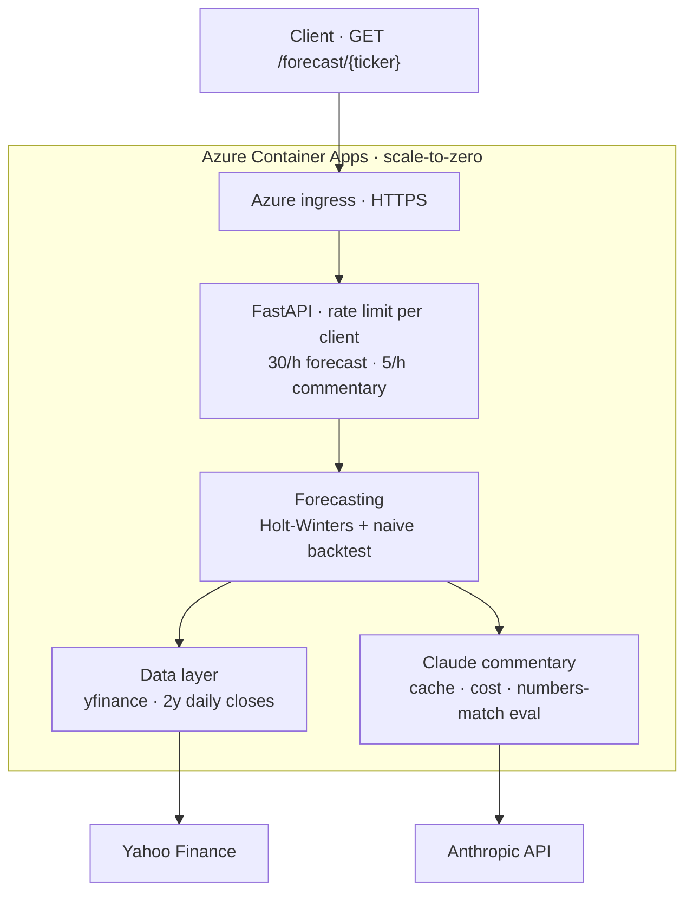
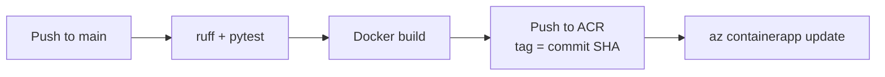

# ForecastPilot 📈

**Time-series forecasting + AI-generated market commentary, shipped as a production-grade service.**

A FastAPI service that pulls market data, produces a statistical forecast with backtest metrics, and uses Claude (Anthropic API) to generate a bilingual (EN/DE) management commentary — with token/cost tracking and an automated "numbers-match" guard against hallucinated figures.

> ⚠️ Educational portfolio project — **not investment advice**.

## Live demo

**https://forecastpilot.mangotree-f644cfcc.germanywestcentral.azurecontainerapps.io/docs**

The service runs on Azure Container Apps with scale-to-zero: the first request after a quiet period takes about 20 seconds while a container starts; every request after that answers in well under a second.

Try it from the Swagger page or directly:

```
GET /forecast/SAP.DE?horizon=5&commentary=true&language=de
```

## Why this exists

Built to demonstrate end-to-end ML & GenAI engineering: model serving, containerization, CI/CD, cloud deployment (Azure), observability, and LLM output evaluation.

## Architecture



Infrastructure: Azure Container Apps (scale 0–10 replicas, single-revision mode), image in Azure Container Registry, container console logs in Log Analytics. Every commentary response carries its own token, cost, eval and truncation fields.

Deployment pipeline (`.github/workflows/ci.yml`):



## API

| Endpoint | Description |
| --- | --- |
| `GET /health` | Liveness check, returns `{"status": "ok"}` |
| `GET /forecast/{ticker}` | Forecast for a Yahoo Finance ticker (e.g. `SAP.DE`, `MSFT`), optional commentary |
| `GET /` | Redirects to `/docs` (Swagger UI); `/redoc` is available as well |

Query parameters of `/forecast/{ticker}`:

| Parameter | Default | Range / values | Meaning |
| --- | --- | --- | --- |
| `horizon` | `30` | 5–90 | Trading days to forecast (also the backtest horizon) |
| `commentary` | `false` | `true` / `false` | Generate the Claude commentary (requires an API key, metered separately) |
| `language` | `en` | `en` / `de` | Language of the commentary |

Response fields:

- `ticker`, `horizon_days`, `last_close`, `forecast` (one value per trading day)
- `metrics`: `backtest_horizon`, `mae_model`, `mae_naive`, `mape_model_pct`, `beats_naive`
- `commentary` (only with `commentary=true`): `text`, `model`, `input_tokens`, `output_tokens`, `cost_usd`, `eval`, `stop_reason`, `truncated`, `generated_at`, `cached`

The `eval` block is the numbers-match guard: every number in the text is traced back to the forecast, its metrics or values derived from them (`numbers_checked`, `numbers_matched`, `unmatched`, `passed`). It is an observability signal, not a gate — a failed check does not block the response.

`truncated` is `true` when the model stopped at its token budget (`stop_reason: "max_tokens"`); such a response is returned as is but never cached, so the next request generates a fresh one. The budget (`MAX_TOKENS` in `app/commentary.py`, currently 2048) covers the model's thinking as well as the text — thinking tokens count toward it even though they are not returned. `truncated` and `eval` are independent signals.

### Example

`GET /forecast/SAP.DE?horizon=5&commentary=true&language=de` — a live response from the deployed service (2026-10-21), shortened:

```json
{
  "ticker": "SAP.DE",
  "horizon_days": 5,
  "last_close": 201.55,
  "forecast": [201.44, 201.43, 201.42, 201.41, 201.4],
  "metrics": {
    "backtest_horizon": 5,
    "mae_model": 2.7679,
    "mae_naive": 2.616,
    "mape_model_pct": 1.38,
    "beats_naive": false
  },
  "commentary": {
    "text": "**Kursbewegung:** SAP.DE schloss zuletzt bei 201,55. … (rendered below)",
    "model": "claude-sonnet-5-5",
    "input_tokens": 462,
    "output_tokens": 362,
    "cost_usd": 0.004544,
    "eval": {"numbers_checked": 8, "numbers_matched": 8, "unmatched": [], "passed": true},
    "stop_reason": "end_turn",
    "truncated": false,
    "generated_at": "2026-10-21T23:19:45+00:00",
    "cached": false
  }
}
```

The commentary text (`language=de`), rendered:

> **Kursbewegung:** SAP.DE schloss zuletzt bei 201,55. Die Prognose startet bei 201,44 und endet nach 5 Handelstagen bei 201,40. Das entspricht einer praktisch unveränderten Kursentwicklung.
>
> **Modellgüte:** Im Backtest (Horizont: 5 Tage) liegt der mittlere absolute Fehler des Modells bei 2,7679, der des naiven Vergleichsmodells bei 2,616. Der MAPE des Modells beträgt 1,38 %. Das Modell schlägt die naive Baseline nicht (beats_naive: False).
>
> **Einschränkung:** Die Prognose deutet keine nennenswerte Kursänderung an. Da das Modell im Backtest nicht besser abschneidet als die naive Fortschreibung, hat sie nur begrenzten Zusatznutzen. Sie ist keine Aussage über tatsächliche künftige Kurse oder Risiken.
>
> Bildungsanalyse — keine Anlageberatung.

A daily Holt-Winters forecast often does not beat the naive baseline over a few trading days; the example shows this deliberately. The point of the service is the transparent pipeline around the forecast — backtest metrics, a commentary that only uses the computed numbers, and a check that proves it.

### Errors

| Status | When |
| --- | --- |
| `404` | No market data for the ticker |
| `422` | Invalid parameter, or fewer than 60 daily closes of history |
| `429` | Rate limit exceeded (see below) |
| `502` | `LLM call failed: <reason>` — `authentication`, `rate limit`, `network`, `upstream error (<status>)` or `empty response` |
| `503` | `ANTHROPIC_API_KEY not configured` |

### Rate limits and caching

- Plain forecasts: `30/hour` per client; forecasts with commentary: `5/hour` per client (each one is a paid LLM call). Both are configurable, see below.
- The client is the caller's address. Behind the Azure Container Apps ingress it is taken from `X-Forwarded-For`, trusting only hops from the ingress network (`TRUSTED_PROXY_CIDRS`); entries a caller adds itself are never used.
- Commentary is cached in-process until UTC midnight, keyed by ticker, language, horizon and the numbers the text cites (last close, forecast start and end). A price move during the trading day therefore yields fresh text; unchanged numbers reuse the block.
- With `cached: true`, `model`, `input_tokens`, `output_tokens`, `cost_usd`, `stop_reason` and `generated_at` refer to the original generation (no new LLM call); `truncated` is always `false` on a hit because only complete replies are stored; `eval` is recomputed against the response it is part of.

## Configuration

Copy `.env.example` to `.env` for local runs. In production the key is an Azure Container App secret; model and pricing are versioned in the deploy job of `.github/workflows/ci.yml` and applied on every deploy.

| Variable | Default | Meaning |
| --- | --- | --- |
| `ANTHROPIC_API_KEY` | — | Required for `commentary=true` |
| `ANTHROPIC_MODEL` | `claude-sonnet-5-5` | Claude model for the commentary |
| `ANTHROPIC_PRICE_INPUT_PER_MTOK` | `2.0` | USD per million input tokens, for `cost_usd` |
| `ANTHROPIC_PRICE_OUTPUT_PER_MTOK` | `10.0` | USD per million output tokens, for `cost_usd` |
| `RATE_LIMIT_FORECAST` | `30/hour` | Per-client limit for plain forecasts |
| `RATE_LIMIT_COMMENTARY` | `5/hour` | Per-client limit for forecasts with commentary |
| `COMMENTARY_CACHE_ENABLED` | `true` | `false` always calls the LLM |
| `TRUSTED_PROXY_CIDRS` | — | Networks of trusted reverse proxies; production sets `100.64.0.0/10` (Container Apps ingress) |

Pricing source: https://platform.claude.com/docs/en/about-claude/pricing

## Quickstart (local)

Python 3.11 (the version used in CI and in the container image). With [uv](https://docs.astral.sh/uv/):

```bash
uv venv --python 3.11 .venv && source .venv/bin/activate   # Windows: .venv\Scripts\activate
uv pip install -r requirements-dev.txt
cp .env.example .env                                        # add your ANTHROPIC_API_KEY
uvicorn app.main:app --reload
# open http://127.0.0.1:8000/docs
```

Without uv: `python3.11 -m venv .venv`, then `pip install -r requirements-dev.txt`.

Checks (the same ones CI runs):

```bash
ruff check . && pytest -q
```

Runtime dependencies are pinned in `requirements.txt` to the versions running in production; `requirements-dev.txt` adds `pytest`, `httpx` and `ruff`. The tests run offline — market data and the Anthropic client are replaced by fakes.

## Docker

```bash
docker build -t forecastpilot .
docker run --env-file .env -p 8000:8000 forecastpilot
```

## Deployment

Every push to `main` runs `.github/workflows/ci.yml`: `ruff check` and `pytest` on Python 3.11, a Docker build, then — on `main` only — the image is pushed to Azure Container Registry tagged with the commit SHA and rolled out with `az containerapp update`, which also sets the model and pricing variables. A new revision takes traffic once it is healthy; the previous one serves until then. Pull requests run lint, tests and the Docker build without deploying.

## Roadmap

- [x] **W1–2** Core service local — API, forecasting, LLM layer, tests, Docker
- [x] **W3** Azure Container Apps deploy
- [ ] **W3** Infrastructure as code (Bicep)
- [x] **W4** CI/CD — GitHub Actions deploys on push to `main`
- [x] **W5** Observability — token/cost metrics, LLM eval guard (numbers-match)
- [ ] **W5** Application Insights
- [x] **W6** Polish — live demo URL, architecture diagram
- [ ] **W6** Screenshots
- [ ] **W7** RAG add-on — commentary grounded in uploaded reports, with citations

## Cost controls

- **Anthropic:** input/output tokens and an estimated `cost_usd` tracked per request; commentary rate limit and daily cache keep paid calls low; monthly budget limit set in the console
- **Azure:** budget alert in Cost Management; Container Apps scale to zero when idle

## License

MIT
