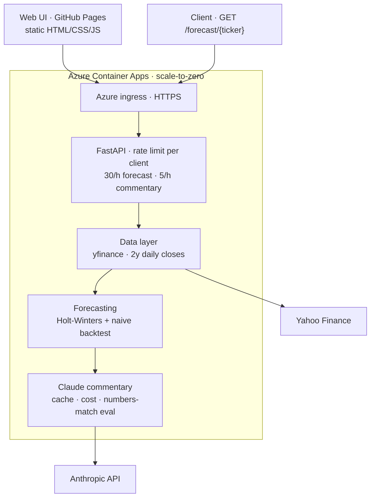
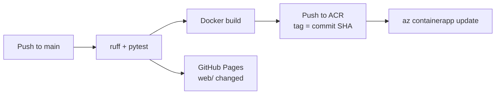

# ForecastPilot 📈

[](https://github.com/timur-us/forecastpilot/actions/workflows/ci.yml)

**Time-series forecasting + AI-generated market commentary, shipped as a production-grade service.**

A FastAPI service that pulls market data, produces a statistical forecast with backtest metrics, and uses Claude (Anthropic API) to generate a bilingual (EN/DE) management commentary — with token/cost tracking and an automated "numbers-match" guard against hallucinated figures.

> ⚠️ Educational portfolio project — **not investment advice**.

## Live demo

### [▶ Open the app](https://timur-us.github.io/forecastpilot/) · [API & Swagger](https://forecastpilot.mangotree-f644cfcc.germanywestcentral.azurecontainerapps.io/docs)

The web app is a static page on GitHub Pages; the API runs on Azure Container Apps with scale-to-zero. The first request after a quiet period takes about 20 seconds while a container starts — the page shows what happens while you wait — and every request after that answers in well under a second.

[](https://timur-us.github.io/forecastpilot/)

Try the API from the Swagger page or directly:

```
GET /forecast/NVDA?horizon=30&commentary=true&language=en
```

## Why this exists

Built to demonstrate end-to-end ML & GenAI engineering: model serving, containerization, CI/CD, cloud deployment (Azure), observability, and LLM output evaluation.

## Architecture



Infrastructure: Azure Container Apps (scale 0–10 replicas, single-revision mode), image in Azure Container Registry, container console logs in Log Analytics. Every commentary response carries its own token, cost, eval and truncation fields.

Deployment pipeline (`.github/workflows/ci.yml`):



## API

| Endpoint | Description |
| --- | --- |
| `GET /health` | Liveness check, returns `{"status": "ok"}` |
| `GET /forecast/{ticker}` | Forecast for a Yahoo Finance ticker (e.g. `NVDA`, or `SAP.DE` for a Xetra listing), optional commentary |
| `GET /` | Redirects to the web app; `/docs` (Swagger UI) and `/redoc` document the API |

Query parameters of `/forecast/{ticker}`:

| Parameter | Default | Range / values | Meaning |
| --- | --- | --- | --- |
| `horizon` | `30` | 5–90 | Trading days to forecast (also the backtest horizon) |
| `commentary` | `false` | `true` / `false` | Generate the Claude commentary (requires an API key, metered separately) |
| `language` | `en` | `en` / `de` | Language of the commentary |

Response fields:

- `ticker`, `horizon_days`, `last_close`, `forecast` (one value per trading day), `history` (the last 60 closes as `{date, close}`)
- `metrics`: `backtest_horizon`, `mae_model`, `mae_naive`, `mape_model_pct`, `beats_naive` — or `note` when the series is too short for a backtest (at most twice the horizon in closes); the app then shows the forecast without a verdict
- `commentary` (only with `commentary=true`): `text`, `model`, `input_tokens`, `output_tokens`, `cost_usd`, `eval`, `stop_reason`, `truncated`, `generated_at`, `cached`

The `eval` block is the numbers-match guard: every number in the text is traced back to the forecast, its metrics or values derived from them (`numbers_checked`, `numbers_matched`, `unmatched`, `passed`). It is an observability signal, not a gate — a failed check does not block the response.

`truncated` is `true` when the model stopped at its token budget (`stop_reason: "max_tokens"`); such a response is returned as is but never cached, so the next request generates a fresh one. The budget (`MAX_TOKENS` in `app/commentary.py`, currently 2048) covers the model's thinking as well as the text — thinking tokens count toward it even though they are not returned. `truncated` and `eval` are independent signals.

### Example

`GET /forecast/NVDA?horizon=30&commentary=true&language=en` — a live response from the deployed service (2026-10-22, 12:17 UTC — an earlier run than the screenshot above, recorded before the `history` field was added), shortened:

```json
{
  "ticker": "NVDA",
  "horizon_days": 30,
  "last_close": 221.97,
  "forecast": [221.78, 221.93, 222.09, "…", 226.03, 226.18, 226.34],
  "metrics": {
    "backtest_horizon": 30,
    "mae_model": 6.1651,
    "mae_naive": 6.4573,
    "mape_model_pct": 2.77,
    "beats_naive": true
  },
  "commentary": {
    "text": "**1. Price movement**\nNVDA last closed at 221.97. … (rendered below)",
    "model": "claude-sonnet-5-5",
    "input_tokens": 461,
    "output_tokens": 265,
    "cost_usd": 0.003572,
    "eval": {"numbers_checked": 8, "numbers_matched": 8, "unmatched": [], "passed": true},
    "stop_reason": "end_turn",
    "truncated": false,
    "generated_at": "2026-10-22T12:17:50+00:00",
    "cached": false
  }
}
```

The commentary text, rendered:

> **1. Price movement**
> NVDA last closed at 221.97. The forecast starts at 221.78 and ends at 226.34 after 30 trading days, which is above the last close.
>
> **2. Model quality**
> Over a 30-day backtest horizon, the model's MAE was 6.1651 versus 6.4573 for the naive baseline. Its MAPE was 2.77%. beats_naive is True, so the model beat the naive baseline, though the margin is narrow.
>
> **3. Interpretation**
> The forecast is a statistical projection from past price patterns. It does not account for earnings, news, or market shocks. A backtest edge over the naive baseline does not guarantee future accuracy. The forecast should be read as one input among several, not as a prediction of the outcome.
>
> Educational analysis — not investment advice.

Whether the model beats the naive baseline depends on the ticker, the window and the horizon. An earlier example in this README (SAP.DE, 5-day horizon, recorded 2026-10-19) lost to the baseline: model MAE 6.88 against 6.37 for the naive forecast. This 30-day NVDA example wins by a narrow margin. Neither is evidence of forecasting skill: it is one backtest window per request, and a trend that happened to continue is not a model that knows the future. The point of the service is that the number is computed, shown and never hidden — switch the horizon in the app and watch the verdict change.

### What the guard caught — and what it missed

The numbers-match guard has been wrong in both directions. Early on it produced false positives on German commentary: a decimal such as `18,6936` was split at the third digit ([`3efe903`](https://github.com/timur-us/forecastpilot/commit/3efe903), 2026-08-09), and the ordinals of the fixed three-part structure (`**1. Kursbewegung**`) and ambiguous forms like `41,828` were read as invented figures ([`ac729d7`](https://github.com/timur-us/forecastpilot/commit/ac729d7), 2026-09-02). The example above contains exactly that pattern — `**1. Price movement**` — which is why the guard counts 8 numbers rather than 11. It also missed a case: on a cache hit it reported `passed` for commentary that belonged to older prices, because the stored evaluation was returned along with the stored text; since [#5](https://github.com/timur-us/forecastpilot/pull/5) the cache key includes the numbers the text cites and the check is recomputed on every hit. These cases, like the rest of the behaviour, are pinned down by the 66 offline tests.

### Errors

| Status | When |
| --- | --- |
| `404` | No market data for the ticker |
| `422` | Invalid parameter, or fewer than 60 daily closes of history |
| `429` | Rate limit exceeded (see below) |
| `502` | `LLM call failed: <reason>` — `authentication`, `insufficient credits or permissions`, `rate limit`, `network`, `upstream error (<status>)`, `refusal`, `empty response (stop_reason=…)` or `unexpected error` |
| `503` | `ANTHROPIC_API_KEY not configured` |

### Rate limits and caching

- Plain forecasts: `30/hour` per client; forecasts with commentary: `5/hour` per client (each one is a paid LLM call). Both are configurable, see below. Every `/forecast` response carries `X-RateLimit-Limit`, `X-RateLimit-Remaining` and `X-RateLimit-Reset` (Unix timestamp, may carry a fraction) plus `Retry-After` (seconds until the window resets).
- The client is the caller's address. Behind the Azure Container Apps ingress it is taken from `X-Forwarded-For`, trusting only hops from the ingress network (`TRUSTED_PROXY_CIDRS`); entries a caller adds itself are never used.
- Commentary is cached in-process until UTC midnight, keyed by ticker, language, horizon and the numbers the text cites (last close, forecast start and end). A price move during the trading day therefore yields fresh text; unchanged numbers reuse the block.
- With `cached: true`, `model`, `input_tokens`, `output_tokens`, `cost_usd`, `stop_reason` and `generated_at` refer to the original generation (no new LLM call); `truncated` is always `false` on a hit because only complete replies are stored; `eval` is recomputed against the response it is part of.

## Configuration

Copy `.env.example` to `.env` for local runs. In production the key is an Azure Container App secret; model and pricing are versioned in the deploy job of `.github/workflows/ci.yml` and applied on every deploy.

| Variable | Default | Meaning |
| --- | --- | --- |
| `ANTHROPIC_API_KEY` | — | Required for `commentary=true` |
| `ANTHROPIC_MODEL` | `claude-sonnet-5-5` | Claude model for the commentary |
| `ANTHROPIC_PRICE_INPUT_PER_MTOK` | `2.0` | USD per million input tokens, for `cost_usd` |
| `ANTHROPIC_PRICE_OUTPUT_PER_MTOK` | `10.0` | USD per million output tokens, for `cost_usd` |
| `RATE_LIMIT_FORECAST` | `30/hour` | Per-client limit for plain forecasts |
| `RATE_LIMIT_COMMENTARY` | `5/hour` | Per-client limit for forecasts with commentary |
| `COMMENTARY_CACHE_ENABLED` | `true` | `false` always calls the LLM |
| `TRUSTED_PROXY_CIDRS` | — | Networks of trusted reverse proxies; production sets `100.64.0.0/10` (Container Apps ingress) |
| `CORS_ORIGINS` | — | Browser origins allowed to call the API; production sets the GitHub Pages origin of the web app |
| `WEB_UI_URL` | `https://timur-us.github.io/forecastpilot/` | Where `GET /` sends browsers |

Pricing source: https://platform.claude.com/docs/en/about-claude/pricing

## Quickstart (local)

Python 3.11 (the version used in CI and in the container image). With [uv](https://docs.astral.sh/uv/):

```bash
uv venv --python 3.11 .venv && source .venv/bin/activate   # Windows: .venv\Scripts\activate
uv pip install -r requirements-dev.txt
cp .env.example .env                                        # add your ANTHROPIC_API_KEY
uvicorn app.main:app --reload
# open http://127.0.0.1:8000/docs
```

Without uv: `python3.11 -m venv .venv`, then `pip install -r requirements-dev.txt`.

To run the web app against the local API, allow its origin and serve `web/` statically:

```bash
CORS_ORIGINS=http://localhost:8080 uvicorn app.main:app --reload   # API on :8000
python -m http.server 8080 --directory web                         # page on :8080
# open http://localhost:8080/?api=http://127.0.0.1:8000
```

The `?api=` override is accepted for `localhost` and `127.0.0.1` only; the published page always talks to the Azure API.

Checks (the same ones CI runs):

```bash
ruff check . && ruff format --check . && pytest -q
```

Runtime dependencies are pinned in `requirements.txt` to the versions running in production; `requirements-dev.txt` adds `pytest`, `httpx` and `ruff`. The tests run offline — market data and the Anthropic client are replaced by fakes.

## Docker

```bash
docker build -t forecastpilot .
docker run --env-file .env -p 8000:8000 forecastpilot
```

## Deployment

Every push to `main` and every pull request runs `.github/workflows/ci.yml`: `ruff check`, `ruff format --check` and `pytest` on Python 3.11, then a Docker build. On `main` a `changes` job diffs the push against the previous head and gates two deployments: when `app/`, `requirements.txt`, the `Dockerfile`, `.dockerignore` or the workflow changed, the image is pushed to Azure Container Registry tagged with the commit SHA and rolled out with `az containerapp update`, which also sets the model, pricing, proxy-trust and CORS variables (a new revision takes traffic once it is healthy; the previous one serves until then); when `web/` changed, the page is published to GitHub Pages. Documentation-only changes deploy nothing; a manual run (`workflow_dispatch`) can redeploy either part.

## Roadmap

- [x] **W1–2** Core service local — API, forecasting, LLM layer, tests, Docker
- [x] **W3** Azure Container Apps deploy
- [ ] **W3** Infrastructure as code (Bicep)
- [x] **W4** CI/CD — GitHub Actions deploys on push to `main`
- [x] **W5** Observability — token/cost metrics, LLM eval guard (numbers-match)
- [ ] **W5** Application Insights
- [x] **W6** Polish — live demo URL, architecture diagram
- [x] **W6** Screenshots
- [x] **Web app** — static page on GitHub Pages with the forecast, the verdict, the commentary and the guard result
- [ ] **W7** RAG add-on — commentary grounded in uploaded reports, with citations

## Cost controls

- **Anthropic:** input/output tokens and an estimated `cost_usd` tracked per request; commentary rate limit and daily cache keep paid calls low; monthly budget limit set in the console
- **Azure:** budget alert in Cost Management; Container Apps scale to zero when idle

## License

MIT
