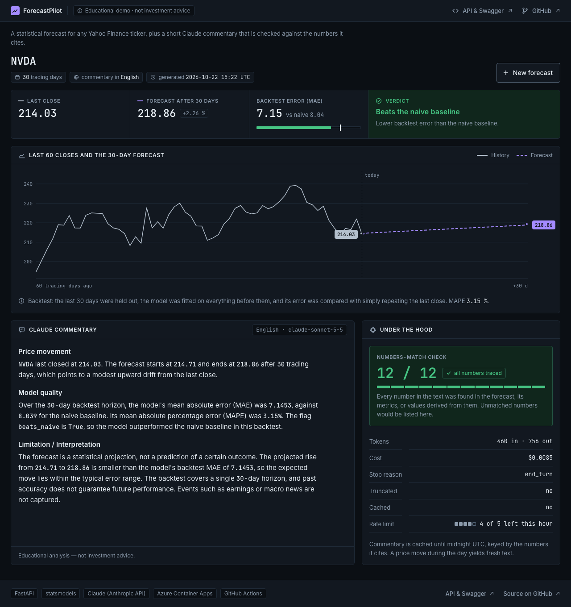
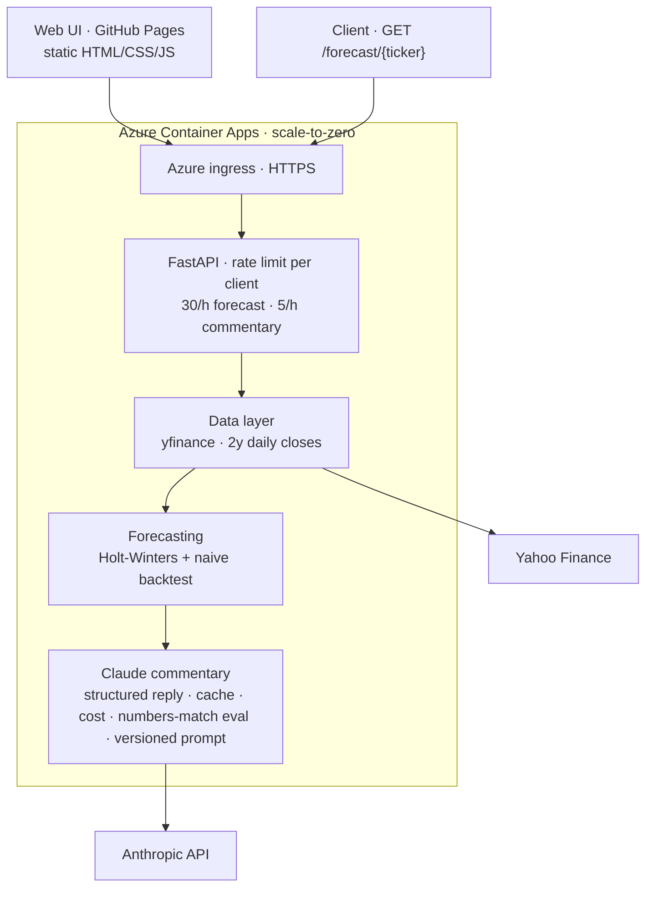
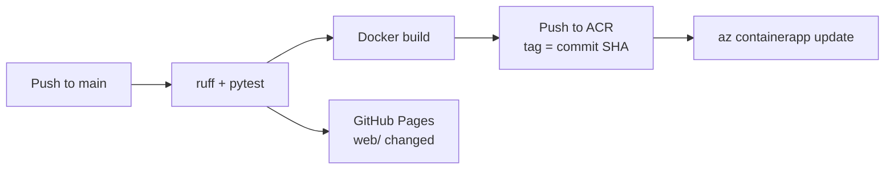

# ForecastPilot 📈

[](https://github.com/timur-us/forecastpilot/actions/workflows/ci.yml)

**Time-series forecasting + AI-generated market commentary, shipped as a production-grade service.**

A FastAPI service that pulls market data, produces a statistical forecast with backtest metrics, and uses Claude (Anthropic API) to generate a bilingual (EN/DE) management commentary — with token/cost tracking and an automated "numbers-match" guard against hallucinated figures.

> ⚠️ Educational portfolio project — **not investment advice**.

## Live demo

### [▶ Open the app](https://timur-us.github.io/forecastpilot/) · [API & Swagger](https://forecastpilot.mangotree-f644cfcc.germanywestcentral.azurecontainerapps.io/docs)

The web app is a static page on GitHub Pages; the API runs on Azure Container Apps with scale-to-zero. The first request after a quiet period takes about 20 seconds while a container starts — the page shows what happens while you wait — and every request after that answers in well under a second.

[](https://timur-us.github.io/forecastpilot/)

Try the API from the Swagger page or directly:

```
GET /forecast/NVDA?horizon=30&commentary=true&language=en
```

## Why this exists

Built to demonstrate end-to-end ML & GenAI engineering: model serving, containerization, CI/CD, cloud deployment (Azure), observability, and LLM output evaluation.

## Architecture



Infrastructure: Azure Container Apps (scale 0–10 replicas, single-revision mode), image in Azure Container Registry, container console logs in Log Analytics. Every commentary response carries its own token, cost, eval, truncation and prompt-version fields.

Deployment pipeline (`.github/workflows/ci.yml`):



## API

| Endpoint | Description |
| --- | --- |
| `GET /health` | Liveness check, returns `{"status": "ok"}` |
| `GET /forecast/{ticker}` | Forecast for a Yahoo Finance ticker (e.g. `NVDA`, or `SAP.DE` for a Xetra listing), optional commentary |
| `GET /` | Redirects to the web app; `/docs` (Swagger UI) and `/redoc` document the API |

Query parameters of `/forecast/{ticker}`:

| Parameter | Default | Range / values | Meaning |
| --- | --- | --- | --- |
| `horizon` | `30` | 5–90 | Trading days to forecast (also the backtest horizon) |
| `commentary` | `false` | `true` / `false` | Generate the Claude commentary (requires an API key, metered separately) |
| `language` | `en` | `en` / `de` | Language of the commentary |

Response fields:

- `ticker`, `horizon_days`, `last_close`, `forecast` (one value per trading day), `history` (the last 60 closes as `{date, close}`)
- `metrics`: `backtest_horizon`, `mae_model`, `mae_naive`, `mape_model_pct`, `beats_naive` — or `note` when the series is too short for a backtest (at most twice the horizon in closes); the app then shows the forecast without a verdict
- `commentary` (only with `commentary=true`): `text`, `sections` (`price_movement`, `model_quality`, `interpretation` as the model wrote them, plus the `verdict` sentence and the `disclaimer` the service rendered), `model`, `prompt_version`, `input_tokens`, `output_tokens`, `cost_usd`, `eval`, `stop_reason`, `truncated`, `generated_at`, `cached`

The `eval` block is the numbers-match guard: every number in the text is traced back to the forecast, its metrics or values derived from them (`numbers_checked`, `numbers_matched`, `unmatched`, `passed`). It is an observability signal, not a gate — a failed check does not block the response.

Since prompt version `2026-10-25.3` the model returns the three parts as a structured reply (JSON constrained by a schema) and the service renders the labels, the verdict sentence and the disclaimer around them, so those cannot be wrong. A reply cut off at the token budget (`stop_reason: "max_tokens"`), a refusal or invalid JSON is answered with `502` and never cached; there is no partial commentary any more, and `truncated` stays in the block for compatibility and is always `false`. The budget (`MAX_TOKENS` in `app/commentary.py`, currently 2048) covers the model's thinking as well as the text — thinking tokens count toward it even though they are not returned.

`prompt_version` names the prompt that produced the text (`PROMPT_VERSION` in `app/commentary.py`: a date plus a counter, bumped with every edit to the prompt). The first label, `2026-10-23.1`, marks the start of versioning; the prompt text itself dates from 2026-08-09. It makes commentary from different prompt revisions distinguishable, so evaluation results can be compared across revisions.

### Example

`GET /forecast/NVDA?horizon=30&commentary=true&language=en` — a live response from the deployed service (2026-10-25, prompt `2026-10-25.3`, later than the screenshot above), shortened:

```json
{
  "ticker": "NVDA",
  "horizon_days": 30,
  "last_close": 210.96,
  "forecast": [211.24, "…", 215.36],
  "metrics": {
    "backtest_horizon": 30,
    "mae_model": 7.7513,
    "mae_naive": 8.372,
    "mape_model_pct": 3.43,
    "beats_naive": true
  },
  "commentary": {
    "text": "**Price movement**\nNVDA last closed at 210.96. … (rendered below)",
    "sections": {"price_movement": "…", "model_quality": "…", "interpretation": "…", "verdict": "The model beats the naive baseline.", "disclaimer": "Educational analysis — not investment advice."},
    "model": "claude-sonnet-5-5",
    "prompt_version": "2026-10-25.3",
    "input_tokens": 877,
    "output_tokens": 240,
    "cost_usd": 0.004154,
    "eval": {"numbers_checked": 8, "numbers_matched": 8, "unmatched": [], "passed": true},
    "stop_reason": "end_turn",
    "truncated": false,
    "cached": false
  }
}
```

The commentary text, rendered. The labels, the verdict sentence and the disclaimer come from the service; the model wrote the prose between them:

> **Price movement**
> NVDA last closed at 210.96. The 30-trading-day forecast starts at 211.24 and ends at 215.36.
>
> **Model quality**
> Over a 30-day backtest, the model had a mean absolute error (MAE) of 7.7513 and a mean absolute percentage error (MAPE) of 3.43 percent. The naive baseline had an MAE of 8.372. The model beats the naive baseline.
>
> **Interpretation**
> The forecast points to a modest upward drift from the last close, but it is a statistical estimate, not a certainty. It does not account for earnings, news or sudden market shocks, and actual prices may deviate by roughly the size of the backtest errors or more. It should be treated as one input among several, not as a trading signal.
>
> Educational analysis — not investment advice.

Whether the model beats the naive baseline depends on the ticker, the window and the horizon. An earlier example in this README (SAP.DE, 5-day horizon, recorded 2026-10-19) lost to the baseline: model MAE 6.88 against 6.37 for the naive forecast. This 30-day NVDA example wins by a narrow margin. Neither is evidence of forecasting skill: it is one backtest window per request, and a trend that happened to continue is not a model that knows the future. The point of the service is that the number is computed, shown and never hidden — switch the horizon in the app and watch the verdict change.

### What the guard caught — and what it missed

The numbers-match guard has been wrong in both directions. Early on it produced false positives on German commentary: a decimal such as `18,6936` was split at the third digit ([`3efe903`](https://github.com/timur-us/forecastpilot/commit/3efe903), 2026-08-09), and the ordinals of the fixed three-part structure (`**1. Kursbewegung**`) and ambiguous forms like `41,828` were read as invented figures ([`ac729d7`](https://github.com/timur-us/forecastpilot/commit/ac729d7), 2026-09-02). The example above contains exactly that pattern — `**1. Price movement**` — which is why the guard counts 8 numbers rather than 11. It also missed a case: on a cache hit it reported `passed` for commentary that belonged to older prices, because the stored evaluation was returned along with the stored text; since [#5](https://github.com/timur-us/forecastpilot/pull/5) the cache key includes the numbers the text cites and the check is recomputed on every hit. On 2026-10-25 it read the 500 in "S&P 500" as a cited figure, in all three samples of one eval case; the fix is logged in the eval report with those samples as its evidence. These cases, like the rest of the behaviour, are pinned down by the 160 offline tests.

### Evaluation

The guard checks one response at a time. `evals/` turns it into a suite that measures the commentary against what the prompt demands, offline and per prompt version:

- **Golden set** — 20 synthetic payloads in `evals/cases/` (10 English, 10 German): `beats_naive` true and false, horizons 5, 30 and 90, a DAX level above 10,000, a price below 1, two cases without a backtest in the form the API returns, negative drift, a flat forecast, a very high MAPE, a four-decimal metric and two hairline verdicts. No market data is involved.
- **Eleven metrics** in `evals/score.py`, each pass/fail with a reason. Seven contract metrics measure what the prompt demands: `numbers_match` (the guard: no number that is not in the data), `coverage` (part 1 cites the last close, the forecast start and the forecast end: the guard's counterpart), `language`, `structure`, `verdict` (part 2 names the naive baseline and does not contradict `beats_naive`; without a backtest it says so and cites no metric figure), `length` (150 words including labels and disclaimer) and `complete` (`stop_reason: end_turn`). What the prompt leaves open — the form of the labels, how words are counted, number formats, the wording of the verdict, a title line — is never counted as a model failure; the scorer records it as a hint under twelve documented spec gaps, the input for the next prompt revision. Four communication metrics measure weaknesses the baseline showed within the contract: `jargon_free` (no `beats_naive`, `True`/`False` or dict keys in the prose), `locale_numbers` (number format of the target language), `no_title_line` and `label_format` (each label a line of exactly `**Name**`, which the web app renders as a heading). They are metrics, not gates.
- **Golden set and hold-out** — prompt rules are derived from the 20 golden cases only; a hold-out set of 6 cases in `evals/holdout/` (3 English, 3 German, one without backtest, one DAX-sized level) is only ever scored and reported separately.
- **Recorded baseline** — `python -m evals.run --record --yes` generates three samples per case through the model step (`call_model`: the Anthropic API directly, cache bypassed) after printing the number of calls and the estimated cost; it never runs in CI. `python -m evals.run` scores the recorded files offline and writes `evals/results/<prompt_version>.md`.

Four prompt versions were recorded with the same suite and the same scorer, Claude Sonnet 5.5, golden set 20 cases × 3 samples and hold-out 6 × 3 each (full reports in [`evals/results/`](evals/results/)). One change per version, so every difference has one cause. Cases passing all three samples; hold-out in brackets.

| Metric | v1 `2026-10-23.1` baseline | v2 `2026-10-25.1` rules, rejected | v2.1 `2026-10-25.2` rules | v3 `2026-10-25.3` structured outputs |
| --- | --- | --- | --- | --- |
| jargon_free | 0/20 (0/6) | 20/20 (6/6) | 20/20 (6/6) | 20/20 (6/6) |
| locale_numbers | 15/20 (3/6) | 20/20 (6/6) | 20/20 (6/6) | 20/20 (6/6) |
| no_title_line | 17/20 (6/6) | 20/20 (6/6) | 20/20 (6/6) | 20/20 (6/6), by construction |
| label_format | 3/20 (0/6) | 20/20 (6/6) | 20/20 (6/6) | 20/20 (6/6), by construction |
| numbers_match | 20/20 (6/6) | 17/20 (3/6) | 20/20 (6/6) | 20/20 (6/6) |
| structure | 20/20 (6/6) | 18/20 (5/6) | 20/20 (6/6) | 20/20 (6/6), by construction |
| length | 20/20 (6/6) | 19/20 (5/6) | 20/20 (6/6) | 20/20 (6/6) |
| verdict, coverage, complete, language | all 100% | all 100% | all 100% | all 100% (verdict sentence by construction) |
| mean output tokens / cost per commentary | 474 / 0.0057 USD | 327 / 0.0048 USD | 321 / 0.0048 USD | 277 / 0.0045 USD |

What each step did:

- **Prompt rules (v2 → v2.1)** brought every communication gain: `jargon_free` 0 → 20 from the rule to write plain prose without field names; `locale_numbers` 15 → 20 from the number-format rule; `no_title_line` 17 → 20 from "nothing before the first label"; `label_format` 3 → 20 from fixing the three labels per language as bold lines, which the web app renders as headings.
- **v2 was rejected.** Its communication metrics rose, but `numbers_match` fell from 20 to 17 cases (hold-out 6 to 3): English replies computed the change between forecast end and last close, a figure not in the data, and two replies restated part 1 after a visible self-correction. It stays in the record. v2.1 adds one rule for part 1 (name the three figures, compute nothing) and nothing else; the computed differences disappear in all 78 replies.
- **Structured outputs (v3)** did not move a metric v2.1 had not already saturated. What it changed: four structural properties are now guaranteed by the code instead of measured on the model (marked "by construction" above, not model performance); a reply cut off at the budget or otherwise invalid is a `502` instead of a partial text; and the commentary costs 14% fewer output tokens than v2.1. No correctness metric fell at any accepted step.
- **One scorer change**, with evidence: the guard read the 500 in "S&P 500" as a cited figure in all three samples of one case; the fix is logged in every report under "Scorer changes".

With three samples per case the suite shows instability, not statistical significance; a difference of one or two cases between prompt versions is noise and is reported as such. A clean result says that a prompt is followed on these 26 cases, nothing about cases outside the set, and the heuristics have documented limits (a keyword-based verdict, a function-word language check).

The pytest in `tests/test_evals_suite.py` is the CI gate for the scorer itself: it pins two real replies of the first prompt version as clean samples, shows every metric detecting its failure case on artificial answers, and rebuilds the committed report from the recorded files. A prompt change is judged by comparing two reports under a rule written into every report before a second version existed: a version is better when the four communication metrics rise and no correctness metric (`numbers_match`, `verdict`, `coverage`, `complete`) falls. The correctness metrics are also a regression gate in CI: the newest recorded version must not pass fewer cases than the previous one. Everything else is a metric, not a gate. `prompt_version` on every commentary block ties a report to the prompt it measures.

### Errors

| Status | When |
| --- | --- |
| `404` | No market data for the ticker |
| `422` | Invalid parameter, or fewer than 60 daily closes of history |
| `429` | Rate limit exceeded (see below) |
| `502` | `LLM call failed: <reason>` — `authentication`, `insufficient credits or permissions`, `rate limit`, `network`, `upstream error (<status>)`, `refusal`, `empty response (stop_reason=…)`, `incomplete structured reply (stop_reason=max_tokens)`, `invalid structured reply: …` or `unexpected error` |
| `503` | `ANTHROPIC_API_KEY not configured` |

### Rate limits and caching

- Plain forecasts: `30/hour` per client; forecasts with commentary: `5/hour` per client (each one is a paid LLM call). Both are configurable, see below. Every `/forecast` response carries `X-RateLimit-Limit`, `X-RateLimit-Remaining` and `X-RateLimit-Reset` (Unix timestamp, may carry a fraction) plus `Retry-After` (seconds until the window resets).
- The client is the caller's address. Behind the Azure Container Apps ingress it is taken from `X-Forwarded-For`, trusting only hops from the ingress network (`TRUSTED_PROXY_CIDRS`); entries a caller adds itself are never used.
- Commentary is cached in-process until UTC midnight, keyed by ticker, language, horizon, the numbers the text cites (last close, forecast start and end) and the prompt version. A price move during the trading day therefore yields fresh text; unchanged numbers reuse the block.
- With `cached: true`, `model`, `prompt_version`, `input_tokens`, `output_tokens`, `cost_usd`, `stop_reason` and `generated_at` refer to the original generation (no new LLM call); `truncated` is always `false`; `eval` is recomputed against the response it is part of.

## Configuration

Copy `.env.example` to `.env` for local runs. In production the key is an Azure Container App secret; model and pricing are versioned in the deploy job of `.github/workflows/ci.yml` and applied on every deploy.

| Variable | Default | Meaning |
| --- | --- | --- |
| `ANTHROPIC_API_KEY` | — | Required for `commentary=true` |
| `ANTHROPIC_MODEL` | `claude-sonnet-5-5` | Claude model for the commentary |
| `ANTHROPIC_PRICE_INPUT_PER_MTOK` | `2.0` | USD per million input tokens, for `cost_usd` |
| `ANTHROPIC_PRICE_OUTPUT_PER_MTOK` | `10.0` | USD per million output tokens, for `cost_usd` |
| `RATE_LIMIT_FORECAST` | `30/hour` | Per-client limit for plain forecasts |
| `RATE_LIMIT_COMMENTARY` | `5/hour` | Per-client limit for forecasts with commentary |
| `COMMENTARY_CACHE_ENABLED` | `true` | `false` always calls the LLM |
| `TRUSTED_PROXY_CIDRS` | — | Networks of trusted reverse proxies; production sets `100.64.0.0/10` (Container Apps ingress) |
| `CORS_ORIGINS` | — | Browser origins allowed to call the API; production sets the GitHub Pages origin of the web app |
| `WEB_UI_URL` | `https://timur-us.github.io/forecastpilot/` | Where `GET /` sends browsers |

Pricing source: https://platform.claude.com/docs/en/about-claude/pricing

## Quickstart (local)

Python 3.11 (the version used in CI and in the container image). With [uv](https://docs.astral.sh/uv/):

```bash
uv venv --python 3.11 .venv && source .venv/bin/activate   # Windows: .venv\Scripts\activate
uv pip install -r requirements-dev.txt
cp .env.example .env                                        # add your ANTHROPIC_API_KEY
uvicorn app.main:app --reload
# open http://127.0.0.1:8000/docs
```

Without uv: `python3.11 -m venv .venv`, then `pip install -r requirements-dev.txt`.

To run the web app against the local API, allow its origin and serve `web/` statically:

```bash
CORS_ORIGINS=http://localhost:8080 uvicorn app.main:app --reload   # API on :8000
python -m http.server 8080 --directory web                         # page on :8080
# open http://localhost:8080/?api=http://127.0.0.1:8000
```

The `?api=` override is accepted for `localhost` and `127.0.0.1` only; the published page always talks to the Azure API.

Checks (the same ones CI runs):

```bash
ruff check . && ruff format --check . && pytest -q
```

Runtime dependencies are pinned in `requirements.txt` to the versions running in production; `requirements-dev.txt` adds `pytest`, `httpx` and `ruff`. The tests run offline — market data and the Anthropic client are replaced by fakes.

## Docker

```bash
docker build -t forecastpilot .
docker run --env-file .env -p 8000:8000 forecastpilot
```

## Deployment

Every push to `main` and every pull request runs `.github/workflows/ci.yml`: `ruff check`, `ruff format --check` and `pytest` on Python 3.11, then a Docker build. On `main` a `changes` job diffs the push against the previous head and gates two deployments: when `app/`, `requirements.txt`, the `Dockerfile`, `.dockerignore` or the workflow changed, the image is pushed to Azure Container Registry tagged with the commit SHA and rolled out with `az containerapp update`, which also sets the model, pricing, proxy-trust and CORS variables (a new revision takes traffic once it is healthy; the previous one serves until then); when `web/` changed, the page is published to GitHub Pages. Documentation-only changes deploy nothing; a manual run (`workflow_dispatch`) can redeploy either part.

## Roadmap

- [x] **W1–2** Core service local — API, forecasting, LLM layer, tests, Docker
- [x] **W3** Azure Container Apps deploy
- [ ] **W3** Infrastructure as code (Bicep)
- [x] **W4** CI/CD — GitHub Actions deploys on push to `main`
- [x] **W5** Observability — token/cost metrics, numbers-match guard on every commentary response
- [x] **Eval suite** — golden set (20 cases) and hold-out (6), 11 metrics, recorded baseline per prompt version, regression gate in CI
- [x] **Structured outputs** — measured with the eval suite: v1 → v2.1 → v3, before/after table above
- [ ] **W5** Application Insights — moves to project 2
- [x] **W6** Polish — live demo URL, architecture diagram
- [x] **W6** Screenshots
- [x] **Web app** — static page on GitHub Pages with the forecast, the verdict, the commentary and the guard result
- [ ] **W7** RAG add-on — commentary grounded in uploaded reports, with citations — moves to project 2

## Cost controls

- **Anthropic:** input/output tokens and an estimated `cost_usd` tracked per request; commentary rate limit and daily cache keep paid calls low; monthly budget limit set in the console
- **Azure:** budget alert in Cost Management; Container Apps scale to zero when idle

## License

MIT
